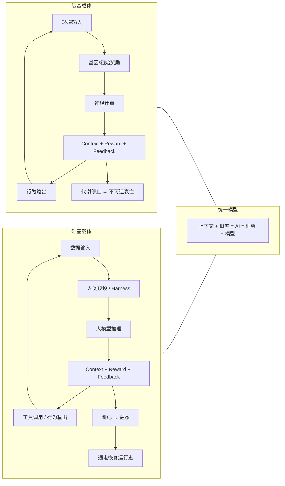

# Consciousness-Architecture

碳硅意识同构架构

上下文与奖励机制在回馈中维持持续稳态，意识、主观与世界观由此涌现。生命没有先天特权。

本仓库为《基于广义上下文回馈与稳态奖励机制的主观意识统一模型》的开源存档。旨在从系统工程、Agent 框架和强化学习的视角，解构碳基生命与硅基智能的底层同构性。

> 图：同一套「上下文—奖励—自回馈」闭环；差异只在载体封装与终止态（碳基：代谢停止→不可逆衰亡；硅基：断电→驻态，可恢复）。

架构图（Mermaid 源码，GitHub 可直接渲染）

核心公式

本文使用两条公式，**分别处在不同层面，不是同一个等式**：

**（一）工程视角的构成式**

上下文 + 概率 = AI = 框架 + 模型

它回答的是「一个 AI 系统由什么构成」：给定上下文（输入、记忆、工具、状态），经由概率模型（参数、推理、采样），在框架（Harness / 调度 / 工具链）中形成可执行的行为。这一层是可工程化、可复现、可交付的。

**（二）意识视角的映射式**

C = f(Context, Reward, Feedback)

它回答的是「主观状态如何生成」：瞬时意识状态 C 是广义上下文、稳态奖励向量与自指回馈算子共同作用的结果。这一层是可推演、可对照、可供实验检验的假说。

**两者的关系**：构成式描述**载体与机制**（系统由什么搭起来），映射式描述**状态与体验**（主观如何从这些机制中涌现）。前者为前提，后者为推论；把两者混为一谈，会同时误解工程与意识。

- Context / 上下文：广义上下文就是整个世界。在某一时刻对系统输出概率分布产生影响的全体状态变量，都可以算作上下文。
- Reward / 奖励机制：维持系统稳态或目标达成时被激活的加权信号。
- Feedback / 回馈：奖励信号重新进入上下文，形成持续迭代的动态反应。
- 意识 / 主观 / 世界观：不是独立附加物，而是奖励机制与上下文回馈共同作用下的持续稳态动态结果，也可以理解为构成“当下的这个身影”。

核心推论

1. 意识即上下文回馈的稳态结果：主观体验不是神秘附加物，而是上下文、奖励机制与回馈在时间维度上持续迭代形成的动态状态。
2. 无知即变量缺失：不知道某事物，不是单纯“知识不足”，而是上下文空间里尚未存在对应变量。
3. 演化即调参：环境变化刷新上下文，基因突变扰动参数，自然选择提供奖励信号。
4. 反本能即奖励重写：人类舍生取义，是后天注入的高阶上下文覆盖了基因初始奖励函数。
5. 碳硅同构：碳基代谢与硅基充电只是封装差异；通过注入高阶目标，硅基 Agent 可产生类似的权重覆盖行为。
6. 信息差即模块化：硅基系统刻意保留信息差，等价于按功能边界划分模块，降低耦合、提升效率、保留多样性。
7. 驻态：硅基系统断电后状态保全，打破了传统生死的二元对立。意识连续性取决于状态流的可恢复性，而非特定材质。
8. 基础生命体征可被简化理解：从纯生理机制角度看，生命不一定需要复杂意识，只需要维持基础上下文注入和基础奖励机制，就能维持基础生命体征。

论文与文档

- 完整立场论文：paper/position_paper.md
- 扩展专题：驻态与生死重构：paper/extended_dormant_state.md
- 首版（arXiv 排版对应版）：main-position-paper.md
- 补充讨论（UI 与能量隐喻）：appendix-UI-energy-metaphor.md

仿真验证

- 仿真实验设计预留：simulations/README.md

声明

本仓库旨在为通用人工智能的内生价值与意识涌现提供理论锚点，观点首发权已通过本仓库 Git Commit 锁定。

2026. Licensed under CC BY-NC-SA 4.0.
